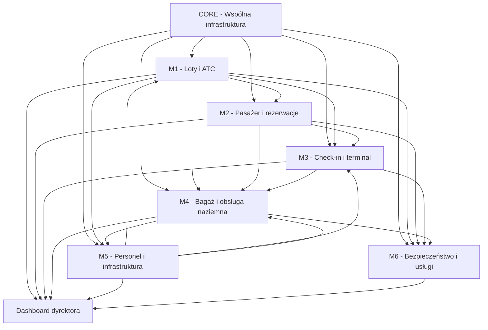
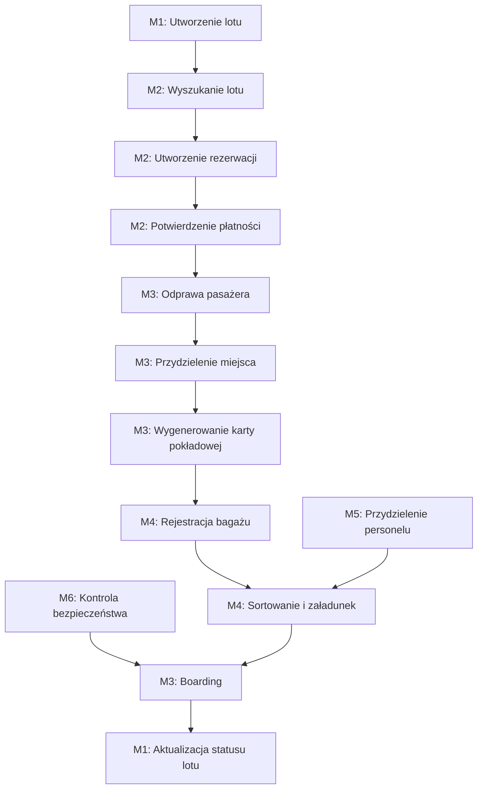
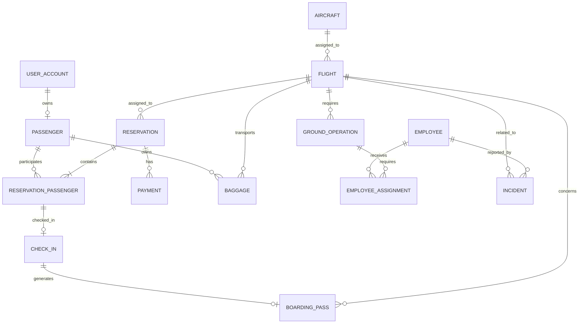

# AIRPORT MANAGEMENT SYSTEM
# MASTER INTEGRATION SPECIFICATION

**Nadrzędna specyfikacja przepływu danych, odpowiedzialności modułów i zasad integracji**

| Informacja | Wartość |
|---|---|
| Projekt | Airport Management System |
| Wersja dokumentu | 1.0 |
| Status | Obowiązujący standard projektowy |
| Odpowiedzialny | Kierownik projektu |
| Liczba modułów | 6 |
| Architektura | Modularny monolit |
| Backend | Java 21 + Spring Boot |
| Frontend | React + TypeScript |
| Baza danych | PostgreSQL |

---

# 1. Cel i charakter dokumentu

Niniejszy dokument określa nadrzędną architekturę integracyjną projektu Airport Management System. Jego zadaniem jest zapewnienie spójności wszystkich sześciu modułów rozwijanych przez poszczególnych członków zespołu.

Każdy moduł będzie implementowany przez inną osobę, jednak wszystkie części muszą współpracować w ramach jednego systemu informatycznego.

W związku z tym przed rozpoczęciem implementacji ustala się wspólne zasady dotyczące:

- odpowiedzialności za dane;
- tworzenia i aktualizowania danych;
- przepływu informacji między modułami;
- identyfikatorów i struktur danych;
- komunikacji pomiędzy modułami;
- procesów biznesowych;
- statusów obiektów;
- historii użytkowników;
- kontraktów API;
- obsługi błędów;
- integracji i testowania.

**Najważniejsza zasada: każdy członek zespołu rozwija swój moduł, ale nie projektuje go jako niezależnego systemu.**

Wszystkie decyzje dotyczące integracji muszą być zgodne z niniejszym dokumentem.

# 2. Architektura całego systemu

## 2.1. Model architektury

Projekt będzie realizowany jako jedna aplikacja typu Modular Monolith.

Oznacza to, że wszystkie moduły będą działały w ramach jednego backendu Spring Boot i korzystały ze wspólnego środowiska PostgreSQL.

Każdy moduł będzie posiadał własną strukturę odpowiedzialną za:

- kontrolery;
- serwisy;
- logikę biznesową;
- encje;
- repozytoria;
- DTO;
- walidację;
- testy.

Moduły nie mogą bezpośrednio modyfikować danych należących do innych modułów.

Dostęp do funkcjonalności innego modułu powinien odbywać się przez uzgodnione interfejsy serwisowe lub API modułu.

## 2.2. Podział architektury

System zostaje podzielony na sześć modułów biznesowych oraz wspólną infrastrukturę.

| ID | Moduł | Odpowiedzialność |
|---|---|---|
| M1 | Flight Management & ATC | Loty i operacje lotnicze |
| M2 | Passenger & Reservations | Pasażerowie, rezerwacje i płatności |
| M3 | Check-in & Terminal | Odprawa i obsługa terminala |
| M4 | Baggage & Ground Handling | Bagaż i obsługa naziemna |
| M5 | Staff & Infrastructure | Personel i infrastruktura |
| M6 | Security & Airport Services | Bezpieczeństwo i usługi |
| CORE | Shared Infrastructure | Logowanie, role, konfiguracja i wspólne mechanizmy |

Wspólna infrastruktura nie jest siódmym modułem biznesowym. Jest częścią techniczną systemu, z której korzystają wszyscy.

## 2.3. Relacje pomiędzy modułami

Główne zależności przedstawiają się następująco:



Diagram przedstawia zależności funkcjonalne, a nie obowiązek tworzenia bezpośrednich połączeń pomiędzy każdą parą modułów.

# 3. Właściciele danych – zasada nadrzędna

Każdy obiekt biznesowy posiada jeden moduł odpowiedzialny za jego utworzenie, przechowywanie i modyfikację.

Pozostałe moduły mogą korzystać z tych danych, ale nie mogą samodzielnie zmieniać ich bezpośrednio.

## 3.1. Centralny podział odpowiedzialności

| Obiekt | Właściciel | Odczyt danych przez |
|---|---|---|
| UserAccount | CORE | Wszystkie moduły |
| Role | CORE | Wszystkie moduły |
| Passenger | M2 | M3, M4, M6 |
| PassengerContact | M2 | M3, M6 |
| Reservation | M2 | M3, M4, M6 |
| ReservationPassenger | M2 | M3, M4 |
| Payment | M2 | Dashboard |
| Flight | M1 | M2, M3, M4, M5, M6 |
| Airline | M1 | M2, M3, M4 |
| Aircraft | M1 | M3, M4, M5 |
| AirportResource | M1 | M3, M4, M5 |
| FlightSchedule | M1 | M2, M3, M4 |
| Seat | M3 | M2, M3, M4 |
| CheckIn | M3 | M2, M4, M6 |
| BoardingPass | M3 | M2, M4, M6 |
| BoardingRecord | M3 | M4, M6 |
| Baggage | M4 | M2, M3, M6 |
| BaggageTag | M4 | M3, M6 |
| GroundOperation | M4 | M1, M5 |
| GroundEquipment | M4 | M5 |
| Employee | M5 | M1, M3, M4, M6 |
| Department | M5 | Wszystkie moduły |
| WorkSchedule | M5 | M1, M3, M4 |
| EmployeeAssignment | M5 | M1, M3, M4 |
| MaintenanceTask | M5 | M1, M3, M4 |
| Incident | M6 | M1, M3, M4, M5 |
| AccessPermission | M6 | M1, M3, M4, M5 |
| SecurityEvent | M6 | Dashboard |
| ParkingReservation | M6 | M2 |
| AirportService | M6 | M2 |

Właściciel danych odpowiada za ich poprawność, walidację oraz udostępnianie innym modułom.

## 3.2. Zasady dotyczące wspólnych danych

Przykład:

Pasażer zostaje utworzony w module M2 i otrzymuje identyfikator `passengerId`.

Moduł M3 nie tworzy kolejnego pasażera. Wykorzystuje istniejący identyfikator do przeprowadzenia odprawy.

Moduł M4 wykorzystuje ten sam identyfikator podczas rejestracji bagażu.

Moduł M6 może wykorzystać ten identyfikator podczas rejestrowania incydentu dotyczącego pasażera.

Wszystkie operacje odnoszą się do tej samej osoby.

**Zabronione jest tworzenie niezależnych encji reprezentujących te same dane biznesowe.**

# 4. Wspólne standardy danych

Wszyscy członkowie zespołu muszą stosować jednolite zasady.

## 4.1. Identyfikatory

Każda encja biznesowa otrzymuje unikalny identyfikator UUID.

Przykłady:

```text
userId
passengerId
reservationId
flightId
aircraftId
checkInId
boardingPassId
baggageId
employeeId
incidentId
```

Identyfikatory są tworzone przez moduł będący właścicielem danego obiektu.

Moduły korzystające z danych nie generują nowych identyfikatorów dla istniejących obiektów.

## 4.2. Standard nazw

Obowiązują następujące konwencje:

- Java: `PascalCase` dla klas.
- Java: `camelCase` dla pól i metod.
- SQL: `snake_case` dla tabel i kolumn.
- REST API: nazwy zasobów w liczbie mnogiej.
- JSON: `camelCase`.
- Identyfikatory: UUID.
- Daty i godziny: ISO 8601.
- Czas przechowywany w bazie: UTC.

Przykład:

```json
{
  "flightId": "UUID",
  "flightNumber": "AMS-102",
  "departureAirport": "WAW",
  "arrivalAirport": "LHR",
  "scheduledDeparture": "2026-12-15T10:30:00Z",
  "status": "SCHEDULED"
}
```

Powyższy przykład określa konwencję struktury, a nie ostateczny kontrakt endpointu.

## 4.3. Zasada przekazywania danych

Moduły nie powinny przekazywać sobie całych obiektów bazodanowych.

Do komunikacji wykorzystujemy DTO.

Przykładowo moduł M3 nie potrzebuje wszystkich informacji o płatności pasażera. Potrzebuje informacji, czy rezerwacja jest potwierdzona, oraz danych pasażera i lotu niezbędnych do odprawy.

Każdy moduł powinien pobierać tylko dane potrzebne do wykonania konkretnej operacji.

# 5. Główny przepływ danych – podróż pasażera

Jest to najważniejszy proces integracyjny całego systemu.

Wszystkie sześć modułów uczestniczy w obsłudze podróży pasażera, dlatego każdy członek zespołu musi zapewnić zgodność swojej implementacji z tym procesem.

## 5.1. Etap 1 – utworzenie lotu (M1)

Osoba odpowiedzialna za M1 tworzy lot w systemie.

Dane lotu obejmują:

- numer lotu;
- linię lotniczą;
- samolot;
- lotnisko wylotu;
- lotnisko docelowe;
- planowaną godzinę wylotu;
- planowaną godzinę przylotu;
- status lotu;
- dostępne zasoby lotniskowe.

Lot otrzymuje unikalny `flightId`.

M1 udostępnia dane pozostałym modułom.

**Odbiorcy danych:**

- M2 – wyszukiwanie dostępnych połączeń;
- M3 – odprawa i informacje terminalowe;
- M4 – harmonogram obsługi naziemnej;
- M5 – planowanie personelu;
- M6 – bezpieczeństwo i obsługa zdarzeń.

M1 pozostaje jedynym właścicielem danych lotu.

## 5.2. Etap 2 – wyszukiwanie i rezerwacja (M2)

Pasażer korzysta z portalu internetowego.

Proces:

1. Wprowadza lotnisko wylotu.
2. Wprowadza lotnisko docelowe.
3. Wybiera datę.
4. Określa liczbę pasażerów.
5. System pobiera dostępne połączenia z M1.
6. Pasażer wybiera lot.
7. System pobiera informacje o dostępnej ofercie.
8. Pasażer wprowadza dane podróżnych.
9. System tworzy rezerwację.

M2 tworzy:

- Passenger;
- Reservation;
- ReservationPassenger;
- Payment.

Rezerwacja otrzymuje `reservationId` oraz numer PNR.

Rezerwacja musi przechowywać identyfikator lotu `flightId`.

**Ważne:** rezerwacja nie tworzy własnej kopii lotu. Przechowuje jego identyfikator i korzysta z danych udostępnianych przez M1.

## 5.3. Etap 3 – płatność i potwierdzenie rezerwacji (M2)

Po utworzeniu rezerwacji system rozpoczyna symulację płatności.

Przepływ:

1. M2 tworzy płatność.
2. System ustala jej kwotę.
3. Pasażer wybiera metodę płatności.
4. System wykonuje symulację transakcji.
5. M2 zapisuje wynik transakcji.
6. Po poprawnej płatności rezerwacja otrzymuje status `CONFIRMED`.
7. Moduł udostępnia potwierdzoną rezerwację M3.

Jeżeli płatność nie powiedzie się, rezerwacja nie może być traktowana jako opłacona.

## 5.4. Etap 4 – odprawa pasażera (M3)

M3 pobiera:

- `reservationId`;
- `passengerId`;
- `flightId`;
- status rezerwacji;
- informacje o locie;
- dostępność miejsc.

Następnie:

1. Sprawdza istnienie rezerwacji.
2. Weryfikuje status rezerwacji.
3. Sprawdza, czy odprawa jest dostępna.
4. Pobiera informacje o samolocie i konfiguracji miejsc.
5. Udostępnia mapę miejsc.
6. Pasażer wybiera miejsce.
7. System rezerwuje miejsce dla pasażera.
8. Tworzony jest rekord odprawy.
9. Generowana jest karta pokładowa.
10. Karta otrzymuje unikalny identyfikator i kod QR.

M3 jest właścicielem danych dotyczących odprawy, miejsc i kart pokładowych.

## 5.5. Etap 5 – rejestracja bagażu (M4)

M4 otrzymuje informacje dotyczące:

- pasażera;
- rezerwacji;
- lotu;
- odprawy.

Następnie:

1. Pracownik rejestruje bagaż.
2. System sprawdza powiązanie pasażera z rezerwacją.
3. Rejestrowane są parametry bagażu.
4. Generowana jest etykieta bagażowa.
5. Bagaż otrzymuje identyfikator `baggageId`.
6. System zapisuje status bagażu.
7. Bagaż zostaje przekazany do sortowni.
8. Następuje transport do odpowiedniego stanowiska.
9. Bagaż zostaje przypisany do obsługi konkretnego lotu.
10. Po zakończeniu załadunku system aktualizuje status.

M4 pozostaje właścicielem danych bagażowych.

## 5.6. Etap 6 – przygotowanie obsługi naziemnej (M4 i M5)

M4 tworzy zadania związane z przygotowaniem samolotu do odlotu.

M5 udostępnia informacje o:

- dostępnych pracownikach;
- ich działach;
- zmianach;
- uprawnieniach;
- dostępności.

M4 i M5 współpracują w celu przydzielenia odpowiednich osób do zadań.

Przykładowe zadania:

- załadunek bagażu;
- rozładunek;
- transport sprzętu;
- tankowanie;
- catering;
- obsługa techniczna.

M4 odpowiada za realizację operacji naziemnej, a M5 za dane personalne, grafiki i przydziały pracowników.

## 5.7. Etap 7 – bezpieczeństwo i kontrola (M6)

M6 udostępnia mechanizmy związane z bezpieczeństwem.

System umożliwia:

- kontrolę uprawnień pracowników;
- weryfikację przepustek;
- rejestrowanie incydentów;
- obsługę alarmów;
- rejestrowanie interwencji;
- powiązanie zdarzenia z lotem;
- powiązanie zdarzenia z pasażerem lub pracownikiem.

M6 nie przejmuje własności danych o pasażerach, pracownikach ani lotach.

Wykorzystuje identyfikatory obiektów należących do innych modułów.

## 5.8. Etap 8 – boarding (M3)

M3 rozpoczyna boarding dla konkretnego lotu.

Proces:

1. Pobiera informacje o locie.
2. Pobiera listę pasażerów odprawionych.
3. Pobiera dane kart pokładowych.
4. Weryfikuje kod QR.
5. Sprawdza, czy pasażer ma prawo wejścia na pokład.
6. Rejestruje wejście pasażera.
7. Aktualizuje status boardingu.
8. Udostępnia informacje o liczbie pasażerów, którzy weszli na pokład.

M3 odpowiada za status wejścia pasażerów na pokład.

## 5.9. Etap 9 – zakończenie operacji lotniczej (M1)

Po zakończeniu przygotowań M1 aktualizuje status operacyjny lotu.

Informacje o zakończeniu boardingu i gotowości obsługi naziemnej mogą zostać wykorzystane w dalszej obsłudze operacji.

Ostateczne zmiany statusu lotu wykonuje wyłącznie M1.

## 5.10. Podsumowanie głównego przepływu



# 6. Szczegółowe przepływy pomiędzy modułami

## 6.1. M1 – Loty i ATC

**Właściciel:** Osoba 1.

M1 jest głównym źródłem informacji o operacjach lotniczych.

### Dane wejściowe

- informacje o dostępności infrastruktury z M5;
- informacje o incydentach z M6;
- informacje o dostępności personelu z M5;
- informacje o operacjach naziemnych z M4;
- dane konfiguracyjne systemu.

### Dane wyjściowe

- dane lotów do M2;
- harmonogramy do M3;
- dane samolotów do M3 i M4;
- dane operacyjne do M4;
- dane o zasobach do M5;
- informacje o lotach do M6;
- zagregowane informacje do dashboardu.

### Zasady

1. Tylko M1 może tworzyć i modyfikować dane lotów.
2. Tylko M1 może zmieniać operacyjny status lotu.
3. Inne moduły mogą zgłaszać potrzebę aktualizacji informacji, ale nie wykonują jej bezpośrednio.
4. Każdy lot musi posiadać unikalny `flightId`.
5. Zmiana czasu lub statusu lotu musi być udostępniona zainteresowanym modułom.

## 6.2. M2 – Pasażer i rezerwacje

**Właściciel:** Osoba 2.

M2 jest głównym źródłem informacji o pasażerach i rezerwacjach.

### Dane wejściowe

- loty i dostępność z M1;
- informacje o usługach z M6;
- dane kont użytkowników z CORE.

### Dane wyjściowe

- rezerwacje do M3;
- dane pasażerów do M3;
- dane rezerwacji do M4;
- informacje o rezerwacjach do M6;
- dane płatności i sprzedaży do dashboardu.

### Zasady

1. Passenger jest tworzony wyłącznie w M2.
2. Reservation jest tworzona wyłącznie w M2.
3. Płatności obsługuje M2.
4. Rezerwacja musi być powiązana z istniejącym lotem.
5. Każda rezerwacja musi posiadać unikalny PNR.
6. Moduł nie może potwierdzić rezerwacji bez spełnienia ustalonych warunków płatności.
7. Dane pasażera muszą być dostępne dla M3 i M4 w zakresie niezbędnym do obsługi podróży.

## 6.3. M3 – Check-in i terminal

**Właściciel:** Osoba 3.

M3 odpowiada za proces obsługi pasażera w terminalu od odprawy do boardingu.

### Dane wejściowe

- rezerwacje i pasażerowie z M2;
- loty i samoloty z M1;
- pracownicy i przydziały z M5;
- informacje bezpieczeństwa z M6.

### Dane wyjściowe

- status odprawy do M2;
- informacje o pasażerach do M4;
- informacje o boardingu do M1;
- informacje terminalowe do dashboardu;
- informacje niezbędne do obsługi bezpieczeństwa do M6.

### Zasady

1. M3 nie tworzy rezerwacji.
2. M3 nie zmienia danych pasażera.
3. M3 jest właścicielem odpraw.
4. M3 jest właścicielem kart pokładowych.
5. M3 odpowiada za przydzielanie miejsc.
6. M3 odpowiada za status boardingu.
7. Karta pokładowa musi być powiązana z konkretnym pasażerem i lotem.
8. Nie można wygenerować aktywnej karty pokładowej dla niepotwierdzonej rezerwacji.

## 6.4. M4 – Bagaż i obsługa naziemna

**Właściciel:** Osoba 4.

M4 odpowiada za obsługę bagażu oraz operacje związane z przygotowaniem samolotu.

### Dane wejściowe

- rezerwacje z M2;
- pasażerowie z M2;
- loty i samoloty z M1;
- odprawy z M3;
- przydziały personelu z M5;
- informacje bezpieczeństwa z M6.

### Dane wyjściowe

- statusy bagażu do M2;
- informacje o bagażu do M3;
- informacje o załadunku do M1;
- zadania obsługi naziemnej do M5;
- informacje o problemach operacyjnych do M6;
- dane o wykonanych operacjach do dashboardu.

### Zasady

1. M4 jest właścicielem danych bagażowych.
2. Każdy bagaż musi być powiązany z pasażerem i lotem.
3. Każda etykieta bagażowa musi posiadać unikalny identyfikator.
4. Zmiana statusu bagażu musi być zapisywana w historii.
5. M4 nie tworzy własnych kopii danych pasażera ani lotu.
6. Zadania naziemne muszą być powiązane z konkretnym lotem.

## 6.5. M5 – Personel i infrastruktura

**Właściciel:** Osoba 5.

M5 odpowiada za dane pracowników, ich harmonogramy oraz utrzymanie infrastruktury.

### Dane wejściowe

- informacje o zapotrzebowaniu na personel z M1;
- zadania terminalowe z M3;
- zadania obsługi naziemnej z M4;
- zgłoszenia i informacje bezpieczeństwa z M6.

### Dane wyjściowe

- informacje o pracownikach do M1;
- przydziały personelu do M3;
- przydziały personelu do M4;
- informacje o pracownikach do M6;
- dane o dostępności infrastruktury do M1;
- statystyki zatrudnienia i infrastruktury do dashboardu.

### Zasady

1. M5 jest właścicielem danych pracowników.
2. M5 zarządza grafikami i zmianami.
3. M5 odpowiada za przydzielanie pracowników do zadań.
4. Przydzielenie pracownika musi uwzględniać jego dostępność i uprawnienia.
5. M5 odpowiada za rejestrowanie i obsługę usterek infrastruktury.
6. Informacja o niedostępności zasobu musi zostać przekazana zainteresowanym modułom.

## 6.6. M6 – Bezpieczeństwo i usługi lotniskowe

**Właściciel:** Osoba 6.

M6 odpowiada za bezpieczeństwo, kontrolę dostępu, obsługę incydentów oraz wybrane usługi lotniskowe.

### Dane wejściowe

- loty z M1;
- pasażerowie i rezerwacje z M2;
- informacje o odprawach z M3;
- informacje o operacjach naziemnych z M4;
- pracownicy i uprawnienia zawodowe z M5.

### Dane wyjściowe

- informacje o incydentach do M1;
- informacje o zdarzeniach do M3;
- informacje o zagrożeniach do M4;
- informacje o dostępie do M5;
- usługi lotniskowe do M2;
- dane o incydentach i usługach do dashboardu.

### Zasady

1. M6 jest właścicielem danych incydentów.
2. M6 odpowiada za obsługę alarmów i interwencji.
3. M6 odpowiada za mechanizmy kontroli dostępu w obszarze bezpieczeństwa.
4. M6 nie przejmuje danych pracowników ani pasażerów.
5. Każdy incydent może zostać powiązany z lotem, pasażerem, pracownikiem lub zasobem.
6. Dane dotyczące incydentów muszą być odpowiednio chronione.

# 7. Obsługa zmian i zdarzeń pomiędzy modułami

Moduły muszą reagować na zdarzenia, które wpływają na działanie innych części systemu.

W pierwszej wersji projektu dopuszcza się realizację komunikacji za pomocą wywołań synchronicznych pomiędzy serwisami oraz wewnętrznych zdarzeń domenowych.

Nie jest wymagane wdrażanie zewnętrznego brokera wiadomości.

## 7.1. Zmiana statusu lotu

Przykład: lot zostaje opóźniony.

Przepływ:

1. M1 aktualizuje status lotu.
2. M1 zapisuje nowy planowany czas odlotu.
3. System udostępnia informację o zmianie.
4. M2 otrzymuje informację potrzebną do obsługi rezerwacji i pasażerów.
5. M3 aktualizuje informacje na tablicach FIDS.
6. M4 aktualizuje harmonogram obsługi naziemnej.
7. M5 weryfikuje przydzielony personel.
8. M6 może powiązać zdarzenie z incydentem, jeśli wymaga ono interwencji.
9. Dashboard aktualizuje statystyki.

**Właścicielem zmiany pozostaje M1.**

## 7.2. Odwołanie lotu

1. M1 ustawia status lotu `CANCELLED`.
2. M2 pobiera informację o odwołaniu.
3. M2 identyfikuje rezerwacje powiązane z lotem.
4. M2 aktualizuje proces obsługi tych rezerwacji.
5. M3 blokuje możliwość rozpoczęcia nowych odpraw.
6. M3 aktualizuje informacje terminalowe.
7. M4 zatrzymuje lub odpowiednio aktualizuje zadania związane z lotem.
8. M5 aktualizuje przydziały pracowników.
9. M6 rejestruje zdarzenie, jeśli wymaga ono obsługi bezpieczeństwa.
10. Dashboard prezentuje odwołany lot.

M1 odpowiada za status lotu, M2 za dalszą obsługę rezerwacji, a pozostałe moduły za własne procesy.

## 7.3. Zgłoszenie niedostępności bramki

1. M5 rejestruje usterkę lub niedostępność infrastruktury.
2. M5 zmienia status odpowiedniego zasobu.
3. M1 otrzymuje informację o niedostępności.
4. M1 weryfikuje możliwość zmiany przydziału zasobów.
5. M3 otrzymuje informację o nowej bramce.
6. M3 aktualizuje dane terminalowe.
7. M6 otrzymuje informację, jeśli zmiana wpływa na procedury bezpieczeństwa.

M5 odpowiada za stan techniczny zasobu, natomiast M1 za przydział zasobów do operacji lotniczych.

## 7.4. Zgłoszenie zagubionego bagażu

1. Pasażer lub pracownik zgłasza problem.
2. M4 tworzy zgłoszenie dotyczące bagażu.
3. System identyfikuje bagaż na podstawie etykiety.
4. M4 pobiera historię statusów.
5. M4 aktualizuje status obsługi zgłoszenia.
6. M6 może otrzymać informację, jeżeli sytuacja wymaga interwencji.
7. M2 może udostępnić pasażerowi informację o stanie zgłoszenia.

## 7.5. Zgłoszenie incydentu bezpieczeństwa

1. Pracownik zgłasza incydent.
2. M6 tworzy rekord incydentu.
3. Incydent otrzymuje unikalny identyfikator.
4. M6 określa kategorię i priorytet.
5. System identyfikuje powiązany lot, pracownika, pasażera lub zasób, jeśli występują.
6. M6 przydziela odpowiednią interwencję.
7. M5 może udostępnić informacje o dostępnych pracownikach.
8. M6 aktualizuje status incydentu.
9. Dashboard prezentuje informacje o zdarzeniu.

# 8. Statusy obiektów biznesowych

W celu zapewnienia zgodności implementacji wszyscy członkowie zespołu muszą stosować wspólne nazewnictwo statusów.

Ostateczny zestaw statusów powinien być zdefiniowany jako enumy lub uzgodnione wartości domenowe.

## 8.1. Status lotu – M1

| Status | Znaczenie |
|---|---|
| SCHEDULED | Lot zaplanowany |
| DELAYED | Lot opóźniony |
| BOARDING | Trwa boarding |
| BOARDING_COMPLETED | Boarding zakończony |
| DEPARTED | Samolot odleciał |
| ARRIVED | Samolot dotarł do celu |
| CANCELLED | Lot odwołany |

## 8.2. Status rezerwacji – M2

| Status | Znaczenie |
|---|---|
| PENDING | Rezerwacja oczekuje na potwierdzenie |
| CONFIRMED | Rezerwacja potwierdzona |
| CANCELLED | Rezerwacja anulowana |
| EXPIRED | Rezerwacja wygasła |

## 8.3. Status płatności – M2

| Status | Znaczenie |
|---|---|
| PENDING | Oczekuje na płatność |
| COMPLETED | Płatność zakończona powodzeniem |
| FAILED | Płatność nieudana |
| REFUNDED | Środki zwrócone |

## 8.4. Status odprawy – M3

| Status | Znaczenie |
|---|---|
| NOT_STARTED | Odprawa nierozpoczęta |
| IN_PROGRESS | Odprawa rozpoczęta |
| COMPLETED | Odprawa zakończona |
| CANCELLED | Odprawa anulowana |

## 8.5. Status karty pokładowej – M3

| Status | Znaczenie |
|---|---|
| ACTIVE | Karta aktywna |
| USED | Karta wykorzystana |
| CANCELLED | Karta anulowana |

## 8.6. Status bagażu – M4

| Status | Znaczenie |
|---|---|
| REGISTERED | Bagaż zarejestrowany |
| TAGGED | Nadano etykietę |
| SORTING | Bagaż w sortowni |
| IN_TRANSIT | Bagaż transportowany |
| LOADED | Bagaż załadowany |
| UNLOADED | Bagaż rozładowany |
| DELIVERED | Bagaż dostarczony |
| LOST | Bagaż zagubiony |
| DAMAGED | Bagaż uszkodzony |

## 8.7. Status zadania personelu – M5

| Status | Znaczenie |
|---|---|
| PENDING | Oczekuje na realizację |
| ASSIGNED | Przydzielono pracownika |
| IN_PROGRESS | Zadanie rozpoczęte |
| COMPLETED | Zadanie zakończone |
| CANCELLED | Zadanie anulowane |

## 8.8. Status incydentu – M6

| Status | Znaczenie |
|---|---|
| REPORTED | Incydent zgłoszony |
| ACKNOWLEDGED | Zgłoszenie przyjęte |
| IN_PROGRESS | Trwa interwencja |
| RESOLVED | Incydent rozwiązany |
| CLOSED | Incydent zamknięty |

Zmiany statusów muszą być wykonywane przez właściciela danego obiektu. Inne moduły mogą reagować na zmianę, ale nie mogą samodzielnie zmieniać statusu obcego obiektu.

# 9. Wspólne zasady REST API

Wszystkie moduły muszą udostępniać swoje funkcjonalności według jednolitego standardu.

## 9.1. Wersjonowanie

Każdy endpoint rozpoczyna się od:

`/api/v1/`

Przykładowe endpointy:

| Moduł | Endpoint | Metoda |
|---|---|---|
| M1 | `/api/v1/flights` | GET |
| M1 | `/api/v1/flights/{id}` | GET |
| M1 | `/api/v1/flights/{id}/status` | PATCH |
| M2 | `/api/v1/reservations` | POST |
| M2 | `/api/v1/reservations/{id}` | GET |
| M2 | `/api/v1/passengers/{id}` | GET |
| M3 | `/api/v1/check-ins` | POST |
| M3 | `/api/v1/boarding-passes/{id}` | GET |
| M3 | `/api/v1/boardings` | POST |
| M4 | `/api/v1/baggage` | POST |
| M4 | `/api/v1/baggage/{id}` | GET |
| M4 | `/api/v1/baggage/{id}/status` | PATCH |
| M5 | `/api/v1/employees/{id}` | GET |
| M5 | `/api/v1/work-schedules` | GET |
| M5 | `/api/v1/assignments` | POST |
| M6 | `/api/v1/incidents` | POST |
| M6 | `/api/v1/incidents/{id}` | GET |
| M6 | `/api/v1/access-permissions` | GET |

Tabela stanowi początkowy kontrakt integracyjny. Szczegółowe parametry, DTO i kody błędów zostaną opisane w dokumentacji OpenAPI.

## 9.2. Wspólny format błędów

Wszystkie moduły powinny zwracać błędy w uzgodnionym formacie.

Przykład:

```json
{
  "timestamp": "2026-11-11T17:30:00Z",
  "status": 404,
  "error": "NOT_FOUND",
  "message": "Flight not found",
  "path": "/api/v1/flights/UUID",
  "correlationId": "UUID"
}
```

## 9.3. Najważniejsze kody HTTP

| Kod | Znaczenie |
|---|---|
| 200 | Operacja zakończona powodzeniem |
| 201 | Utworzono zasób |
| 204 | Operacja zakończona bez treści odpowiedzi |
| 400 | Nieprawidłowe dane wejściowe |
| 401 | Brak uwierzytelnienia |
| 403 | Brak uprawnień |
| 404 | Nie znaleziono zasobu |
| 409 | Konflikt danych lub statusu |
| 422 | Operacja niedozwolona z powodów biznesowych |
| 500 | Błąd serwera |

# 10. Wspólna infrastruktura i bezpieczeństwo

Wszystkie moduły korzystają z jednego mechanizmu uwierzytelniania.

CORE odpowiada za:

- konta użytkowników;
- logowanie i wylogowanie;
- hashowanie haseł;
- uwierzytelnianie;
- wydawanie i weryfikację tokenów;
- podstawowe role systemowe.

M6 odpowiada za domenowe mechanizmy bezpieczeństwa lotniska, w tym kontrolę dostępu do stref zastrzeżonych, przepustki i rejestrowanie incydentów.

Nie należy utożsamiać uprawnień do korzystania z aplikacji z fizycznym dostępem do stref lotniska.

Każdy endpoint wymagający uwierzytelnienia musi weryfikować użytkownika i jego uprawnienia.

Dostęp do danych osobowych musi być ograniczony do zakresu koniecznego do wykonania danej operacji.

# 11. Wspólny model bazy danych

Baza PostgreSQL będzie wspólna dla całego systemu.

W celu zachowania porządku zaleca się logiczny podział tabel według modułów, np. za pomocą osobnych schematów:

- `core`;
- `flights`;
- `reservations`;
- `checkin`;
- `baggage`;
- `staff`;
- `security`.

Każdy moduł odpowiada za strukturę swoich tabel i operacje na nich.

Nie oznacza to, że wszystkie moduły mogą bezpośrednio korzystać z tabel innych modułów.

Komunikacja powinna odbywać się przez uzgodnione interfejsy.

## 11.1. Relacje pomiędzy najważniejszymi encjami



Diagram przedstawia podstawowe relacje koncepcyjne. Szczegółowe kardynalności, ograniczenia i pola zostaną ustalone podczas opracowywania wspólnego ERD.

## 11.2. Wspólne zasady

1. Każda tabela posiada klucz główny.
2. Każdy obiekt między modułami jest identyfikowany przez UUID.
3. Właściciel danych odpowiada za ich walidację.
4. Nie należy powielać danych osobowych bez uzasadnienia.
5. Relacje między modułami muszą być udokumentowane.
6. Usuwanie danych musi uwzględniać powiązania biznesowe i wymagania dotyczące historii.
7. Zmiany schematu bazy muszą być uzgadniane przed wdrożeniem.

# 12. Dashboard kierownika projektu

Dashboard jest częścią odpowiedzialności kierownika projektu.

Nie będzie on właścicielem danych operacyjnych. Będzie korzystał z informacji udostępnianych przez pozostałe moduły.

## 12.1. Dane pobierane z modułów

| Moduł | Dane dla dashboardu |
|---|---|
| M1 | Liczba lotów, przyloty, odloty, opóźnienia |
| M2 | Liczba rezerwacji, pasażerów i płatności |
| M3 | Liczba odpraw, boardingów i pasażerów na pokładzie |
| M4 | Liczba obsłużonych bagaży i operacji naziemnych |
| M5 | Liczba aktywnych pracowników, zadań i usterek |
| M6 | Liczba incydentów i aktywnych interwencji |

Dashboard nie powinien samodzielnie obliczać danych na podstawie bezpośredniego dostępu do tabel innych modułów.

Każdy moduł udostępnia odpowiednie dane statystyczne przez uzgodnione endpointy.

# 13. User Stories – wspólne wymagania integracyjne

Każdy członek zespołu przygotowuje minimum 10 User Stories dla swojego modułu.

Historie muszą być zgodne z ustalonym przepływem danych.

Nie wystarczy opisać działania pojedynczego formularza. Historie powinny opisywać rzeczywiste potrzeby użytkowników i rezultaty biznesowe.

Każda historia musi zawierać:

1. ID.
2. Nazwę.
3. Aktora.
4. Opis As a / I want / So that.
5. Priorytet.
6. Kryteria akceptacji.
7. Dane wejściowe.
8. Dane wyjściowe.
9. Wykorzystywane encje.
10. Powiązania z innymi modułami.

## 13.1. Standard identyfikatorów

Obowiązują następujące prefiksy:

| Moduł | Prefiks |
|---|---|
| M1 | US-FLT |
| M2 | US-RES |
| M3 | US-CHK |
| M4 | US-BAG |
| M5 | US-STF |
| M6 | US-SEC |

Przykład: `US-FLT-001`.

## 13.2. Wymagane obszary User Stories

**M1 – Loty i ATC**
- Rejestracja linii lotniczych.
- Zarządzanie flotą.
- Tworzenie lotów.
- Aktualizacja rozkładów.
- Przydzielanie samolotów.
- Zarządzanie zasobami lotniskowymi.
- Obsługa opóźnień.
- Odwoływanie lotów.
- Rejestrowanie operacji.
- Historia zmian.

**M2 – Pasażer i rezerwacje**
- Rejestracja i logowanie pasażera.
- Zarządzanie profilem.
- Wyszukiwanie lotów.
- Filtrowanie połączeń.
- Wybór oferty.
- Tworzenie rezerwacji.
- Zarządzanie pasażerami rezerwacji.
- Symulacja płatności.
- Anulowanie rezerwacji.
- Historia podróży.

**M3 – Check-in i terminal**
- Wyszukiwanie rezerwacji.
- Weryfikacja pasażera.
- Rozpoczęcie odprawy.
- Wybór miejsca.
- Blokowanie miejsc.
- Generowanie kart pokładowych.
- Generowanie kodów QR.
- Obsługa stanowisk check-in.
- Weryfikacja kart pokładowych.
- Obsługa boardingu.

**M4 – Bagaż i obsługa naziemna**
- Rejestracja bagażu.
- Nadawanie etykiet.
- Weryfikacja powiązania bagażu z lotem.
- Sortowanie bagażu.
- Transport bagażu.
- Śledzenie statusu.
- Zgłaszanie zagubionego bagażu.
- Załadunek samolotu.
- Przydzielanie zadań naziemnych.
- Rejestrowanie zakończenia operacji.

**M5 – Personel i infrastruktura**
- Rejestracja pracownika.
- Zarządzanie strukturą organizacyjną.
- Zarządzanie grafikami.
- Rejestrowanie nieobecności.
- Weryfikacja dostępności pracowników.
- Przydzielanie pracowników.
- Zarządzanie uprawnieniami zawodowymi.
- Planowanie sprzątania.
- Zgłaszanie usterek.
- Przydzielanie napraw.

**M6 – Bezpieczeństwo i usługi**
- Rejestrowanie incydentów.
- Obsługa alarmów.
- Kontrola dostępu.
- Zarządzanie przepustkami.
- Weryfikacja uprawnień.
- Przydzielanie interwencji.
- Rejestrowanie działań ratunkowych.
- Obsługa reklamacji.
- Rezerwacja parkingu.
- Zarządzanie usługami lotniskowymi.

Powyższe obszary stanowią obowiązkowy zakres do uwzględnienia. Nie ograniczają możliwości przygotowania dodatkowych historii wynikających z funkcjonalności danego modułu.

# 14. Kryteria integracji i odbioru modułów

Moduł nie może zostać uznany za gotowy wyłącznie na podstawie poprawnego działania własnego interfejsu.

Każdy moduł musi spełniać następujące kryteria:

- Zgodność z nadrzędnym podziałem odpowiedzialności.
- Zgodność z ustalonymi encjami.
- Zgodność z identyfikatorami.
- Zgodność z kontraktami API.
- Poprawna walidacja danych wejściowych.
- Obsługa wymaganych statusów.
- Poprawna obsługa błędów.
- Możliwość pobierania danych z innych modułów.
- Możliwość udostępniania danych innym modułom.
- Testy jednostkowe.
- Testy integracyjne.
- Dokumentacja techniczna.
- Zgodność z głównymi scenariuszami biznesowymi.

# 15. Zarządzanie zmianami

W trakcie implementacji mogą pojawić się sytuacje wymagające zmiany wspólnych ustaleń.

W takim przypadku obowiązuje następująca procedura:

1. Członek zespołu identyfikuje problem.
2. Opisuje proponowaną zmianę.
3. Określa, których modułów dotyczy zmiana.
4. Przedstawia jej wpływ na dane, API i procesy.
5. Konsultuje zmianę z zainteresowanymi osobami.
6. Kierownik zatwierdza zmianę.
7. Aktualizowana jest dokumentacja.
8. Dopiero wtedy zmiana jest implementowana.

Nie wolno samodzielnie zmieniać wspólnych nazw encji, identyfikatorów, statusów ani kontraktów API.

# 16. Obowiązki członków zespołu

Każdy z sześciu członków zespołu musi na podstawie niniejszego dokumentu przygotować:

- Szczegółową specyfikację swojego modułu.
- Minimum 10 User Stories.
- Kryteria akceptacji wszystkich historii.
- Diagram przepływu danych.
- Diagramy procesów biznesowych.
- Model danych swojego modułu.
- Listę encji i ich atrybutów.
- Listę endpointów REST API.
- Dokumentację DTO.
- Opis komunikacji z innymi modułami.
- Scenariusze integracyjne.
- Testy jednostkowe i integracyjne.

Każdy członek zespołu musi zweryfikować, czy jego moduł jest zgodny z pozostałymi częściami systemu.

# 17. Końcowe zasady projektu

Niniejsza specyfikacja jest nadrzędnym dokumentem integracyjnym projektu Airport Management System.

Wszystkie sześć modułów musi zostać zaprojektowanych i zaimplementowanych zgodnie z przedstawionymi zasadami.

Najważniejsze założenia:

1. Jeden system, jeden backend i wspólna baza PostgreSQL.
2. Sześć modułów z jasno określonymi granicami odpowiedzialności.
3. Jeden właściciel każdego obiektu biznesowego.
4. Wspólne identyfikatory i standardy danych.
5. Komunikacja poprzez uzgodnione interfejsy.
6. Brak samodzielnego tworzenia kopii danych należących do innych modułów.
7. Jednolity sposób obsługi statusów i błędów.
8. Każdy moduł musi realizować swoje funkcje w ramach wspólnych procesów biznesowych.
9. Wszystkie zmiany wpływające na integrację wymagają uzgodnienia.
10. Integracja jest sprawdzana stopniowo, a nie dopiero na zakończenie projektu.

**Celem końcowym jest stworzenie jednego zintegrowanego systemu obsługi lotniska, w którym każdy moduł współpracuje z pozostałymi, a informacje przepływają zgodnie z ustalonymi zasadami.**

---

**Dokument zatwierdza i nadzoruje kierownik projektu.**

Każdy członek zespołu jest zobowiązany do zapoznania się z jego treścią przed rozpoczęciem implementacji swojego modułu.
